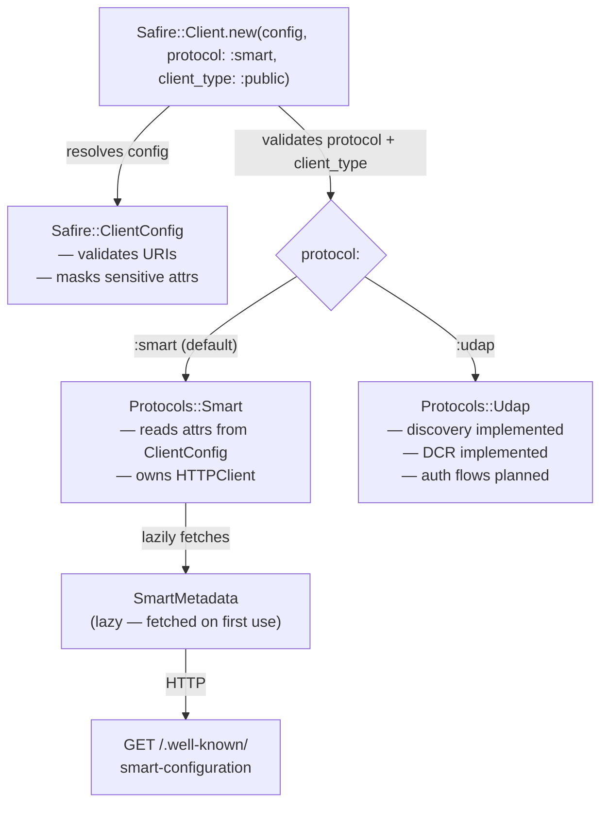

# Configuration

Safire is configured in two places:

- **Client configuration** — the FHIR server URL, credentials, and OAuth parameters passed to `Safire::Client.new`
- **Global configuration** — the logger, log level, HTTP logging behaviour, and `User-Agent` header set once via `Safire.configure`

## Architecture Overview

`Safire::Client` is the public entry point. It owns a `ClientConfig` (validated at construction) and lazily builds a protocol implementation when first used. See [ADR-002]() for the facade design rationale, [ADR-003]() for the `protocol:` / `client_type:` design, and [ADR-006]() for the lazy discovery design.



## Quick Reference

`protocol:` and `client_type:` are keyword arguments to `Safire::Client.new`. All other parameters are keys in the configuration hash (or `Safire::ClientConfig` attributes).

| Parameter | Type | Required | Default | Description |
|-----------|------|----------|---------|-------------|
| `base_url` | String | Yes | — | FHIR server base URL |
| `client_id` | String | No | — | OAuth2 client identifier — required by all authorization flows; validated at call time, not at construction |
| `redirect_uri` | String | No | — | Registered callback URL — required for App Launch flows; not used in Backend Services |
| `protocol:` | Symbol | No | `:smart` | Authorization protocol — `:smart` or `:udap` |
| `client_type:` | Symbol | No | `nil` (→ `:public` for SMART) | SMART client type — `:public`, `:confidential_symmetric`, or `:confidential_asymmetric`; not applicable for `:udap` (any explicit value raises `ConfigurationError`) |
| `client_secret` | String | No | — | Required for `:confidential_symmetric` |
| `private_key` | OpenSSL::PKey / String | No | — | RSA/EC private key; used by SMART asymmetric clients and as the UDAP client signing key |
| `certificate_chain` | Array of PEM strings / OpenSSL::X509::Certificate | No | — | Non-empty, leaf-first, issuer-ordered client certificate chain for UDAP software-statement signing |
| `kid` | String | No | — | Key ID matching the public key registered with the server |
| `jwt_algorithm` | String | No | auto | SMART: `RS384` or `ES384`; UDAP registration: `RS256`, `RS384`, `ES256`, or `ES384`, constrained by the key and server metadata |
| `jwks_uri` | String | No | — | SMART-only URL to the client's public JWKS, included as `jku` in SMART JWT assertions |
| `scopes` | Array | No | — | Default scopes for authorization requests; SMART Backend Services normally uses `system/` scopes and requires explicit values unless passed per request (the v0.4.x fallback is deprecated) |
| `authorization_endpoint` | String | No | — | Override the discovered authorization endpoint |
| `token_endpoint` | String | No | — | Override the discovered token endpoint |

`certificate_chain` and the UDAP algorithm values are used by
`Safire::Client#register_client` when `protocol: :udap`.

## Global Configuration

Set these once at application startup with `Safire.configure`. They apply to every client in the process.

| Setting | Default | Description |
|---------|---------|-------------|
| `logger` | `Logger` to `$stdout` (or the `SAFIRE_LOGGER` path) | Logger used for Safire's messages |
| `log_level` | `Logger::INFO` (default logger) | Level applied to the configured logger |
| `log_http` | `true` | Log outbound HTTP requests and responses (bodies and the `Authorization` header are never logged) |
| `user_agent` | `"Safire v<VERSION>"` | Value of the `User-Agent` header on every request Safire sends |

```ruby
# config/initializers/safire.rb
Safire.configure do |config|
  config.user_agent = "MyApp/2.1 (Safire v#{Safire::VERSION})"
end
```

A `Safire::Client` reads `user_agent` when its first protocol call (for example `server_metadata` or `authorization_url`) builds its HTTP connection. Configure it before using clients; changing it afterwards does not affect a client that has already been used. See [Logging]() for the logging settings.

Safire does not expose TLS/SSL options through its public API. All connections use Faraday's default certificate verification, and endpoint URIs must be HTTPS (HTTP is allowed only for `localhost` / `127.0.0.1` with `allow_insecure_localhost: true`).

## In This Section

- [Client Setup]() — creating a client, protocol and client type selection, URI rules, and credential protection
- [Logging]() — global logger setup, HTTP request logging, log levels, and environment variables
